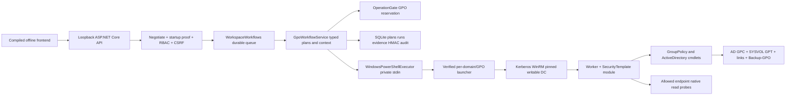

# Full GPO Remediator audit — 2026-10-15

Assessment: **NOT READY for an unrestricted production rollout.** The repaired source/package passes the available local checks; the authoritative benchmark/OS binding, target applicability, client processing and live AD enforcement gates below remain open. This is an end-to-end source/fixture audit, not a certification of an actual domain.

## Scope and counts

405 advertised and registered controls, all inventoried and source/fixture assessed. 394 automatic mappings, 11 intentional manual/review blocks. 19 mapping records changed; 15 confirmed defect groups repaired. 0 automatic controls fail final synthetic checks. **0 controls were fully proved working in live AD; all 405 remain not fully tested for real applicability/enforcement.** The installed ADMX check covers 221 addresses, with zero simple Boolean mismatches; it is not validation of every policy's OS applicability.

The repository inventory covers 220 tracked/new source and distribution files; generated/dist copies are identified rather than counted as independent implementations. SOURCE_INVENTORY.csv records bytes, hashes and text scans; SYMBOL_INVENTORY.csv and API_INVENTORY.csv map entry points. A catalog-to-map set equality check found no missing or duplicate IDs relative to the supplied 405-entry catalog. Missing controls relative to an original authoritative CIS PDF cannot be determined from the supplied catalog alone.

## Architecture and dependencies

| Component | Actual responsibility / dependency |
|---|---|
| backend/Program.cs | Composition, immutable config, protected state, loopback Kestrel, session/setup/service/GPO routes, startup integrity and recovery; no non-Windows fallback |
| Infrastructure/OperatorSecurity, OperatorConfirmation, RequestSecurity | Authenticated operator identity determines role; delegated AD execution identity is separate; exact-origin CSRF, role metadata and startup sign-in/rate limits |
| Infrastructure/Store, PrivateFiles | Microsoft.Data.Sqlite 10.0.13, durable WAL/FULL records, append-only audit/HMAC, DPAPI-protected keys, private ACLs, reparse-point rejection |
| Services/GpoWorkflowService, OperationGate | Ephemeral protected credentials, inventory, mapping/config hashes, allowlists, approvals, per-GPO reservations, operation/result/evidence storage |
| Services/WorkspaceWorkflows and Domain/WorkspaceWorkflow | Bounded server queue, reviewed/rebased batches, first-snapshot rollback anchors, read-only scans and delayed checks; interrupted writes become review, not replay |
| Infrastructure/WindowsPowerShellExecutor, GpoScriptWorkspaces, BundledAssets | Fixed bundled script integrity, private stdin credentials, bounded JSON/stage transport/deadlines; compiled UI and verified domain/GPO-specific launchers |
| PowerShell/Invoke-GpoWorkflow | One delegated Kerberos session to selected writable DC; trusted worker/module text; bounded product-owned error messages |
| PowerShell/GpoWorkflow.Worker | Discovery/preflight, policy conflict preview, Registry/RegistrySet, SecurityTemplate and AdvancedAudit writes, local/full GPO backups, version/CSE changes, links, replication/native probes and guarded restore |
| PowerShell/SecurityTemplate | Strict INI edits and duplicate rejection, CSE GUID pairs, low-16-bit computer version bump, normalized full-GPO content fingerprint |
| frontend/source | client/session/request handling; workspace state/router; catalog/control/operation/product views; workflow-center; automation/setup, enterprise read-only panels; scope picker; reusable components; preferences/AZ-EN/guides and styles |
| GpoRemediator.ps1 / scripts/ServiceControl / Start-ControlPanel | Verified ZIP install, source/runtime fingerprints, canonical protected config, readiness, restart/stop markers and bounded recovery; compatibility wrappers are documented |
| Build-Portable / Tooling | .NET 10 SDK plus Node only on developer build host; self-contained win-x64 runtime, compiled UI/script assets, package hash; no operator SDK download |
| security and CI | Pinned checkout/setup actions; .NET security/workflow fixtures, Python secret/mapping/scope checks, Windows PowerShell fixtures and Playwright Chrome/Edge UI; Authenticode builder requires supplied certificate |

One production project and four regression projects target net10.0. Production also depends on Negotiate 10.0.13 and ProtectedData 10.0.13; HTTP regressions use TestHost. Python and Playwright are test tooling, not runtime dependencies. Each csproj and all package versions are in SOURCE_INVENTORY.csv. Dependency advisory query result is in TEST_RESULTS.md/evidence; it is time-bounded, not a permanent guarantee.

## Exact operator paths

1. **Select CIS control:** benchmark-v4.json → catalog-view/product → workspace.selectRule → syncBackendMappings/ProductionGpoMappings.
2. **Choose domain:** Setup writes one pinned domain/DC config and controlled restart; explicit sign-in connects through GpoWorkflowService.ConnectAsync → gpoInventory. Simultaneous multi-domain browsing is not implemented.
3. **Select GPO:** discovered GUID/name/selectable flags → visual picker. Read-only inventory is not hidden by the production write allowlist.
4. **Select target:** live domain/OU catalog → GpoSelection; user policy separates user OU, endpoint OU and verification user; domain password/lockout requires Default Domain Policy at the root.
5. **Preview:** /api/gpo/preview → typed mapping validation → DC Preview/Validate-Selection → current content/link fingerprint, authority warnings, inventory and conflicts. Readiness may create/delete a backup-directory probe; it does not change a GPO.
6. **Confirm:** change reference, APPLY/impact/protected confirmations → /api/workflows/apply or guarded direct endpoint → ValidateConsent, write gate, GUID/OU/host boundaries and current context.
7. **Apply:** server reservation + durable DC file lock → fresh preview/fingerprint check → full Backup-GPO/manifest → mechanism-specific write → selected link → read-back. Apply worker itself never forces endpoint refresh.
8. **Update:** an explicit approved workflow refresh choice or refresh action → live GPO/rollback preflight → allowed live-scope targets → Invoke-GPUpdate. A workflow with explicit refresh may chain it after Apply; this is not an automatic unapproved repeat.
9. **AD/SYSVOL:** Verification-Metadata → selected/local version + per-DC version/content/CSE checks; unreachable/truncated sets stay pending.
10. **Endpoint:** Verify-EffectiveSamples → current scope membership → at most five allowed endpoints → auditpol / secedit / ActiveStore / typed registry or selected user SID. Domain controls read the selected DC's account-policy properties; fine-grained per-user resultant password policy remains unproved.
11. **Report:** current run → content-addressed evidence snapshot or current workflow JSON/HTML report, explicit five assurance stages, endpoint results and diagnostic candidates. SHA-256 is integrity evidence, not a publisher signature.
12. **Rollback:** snapshot-aware consent/context → post-publication fingerprint and lock → Restore-GPO first snapshot → selected link restoration → content/extensions/link comparison. External changes or interrupted unknown writes require review; explicit refresh may follow the restored snapshot.

## Mechanism-by-mechanism findings

Registry/RegistrySet use GPMC Set-GPRegistryValue, including computer service startup registry settings and Administrative Template values; GPMC owns registry policy serialization/versioning. This is not presented as equivalent to changing service runtime state. Security Options/User Rights/Account Policies use INF templates where mapped and security CSE metadata/version updates. Advanced Audit uses its own audit.csv format and MS-GPAC CSE/tool pair; endpoint auditing uses numeric masks, preserving required include bits. Firewall writes policy inputs but verification now queries active resultant profiles. Defender/SMB/RDP/event logs and other registry-backed controls retain configuration-only runtime limits. All 405 records include the actual storage/method and tested/untested status in CIS_FULL_CONTROL_AUDIT.csv.

Scope enforcement exists in both typed backend rules and the DC worker. Cross-domain/RODC execution is rejected; remote mutation uses the delegated account, never auto-grants Domain Admin. GPO creation is absent. Other existing links are inspected and warned about, not silently removed. Link filtering/precedence analysis is advisory and is not token-accurate endpoint RSoP. WinRM's second-hop limitations are an explicit live-validation gate.

## Evidence and production gates

See ALL_DEFECTS_AND_FIXES.md for all 15 fixes; GPO_CHANGES.md distinguishes software changes from actual AD changes; TEST_RESULTS.md records 35 command checks and full logs; UNVERIFIED_SCENARIOS.md lists all remaining gates. Baseline/final test failures and fixture limitations are retained in the narrative. No simulated policy state is labelled actual AD evidence.

**NO LIVE AD GPO OBJECTS WERE MODIFIED.**

## Authoritative references and limits

- [Microsoft auditpol get](https://learn.microsoft.com/en-us/windows-server/administration/windows-commands/auditpol-get): GUID subcategory queries and CSV reports. The local native read here failed for privilege; remote policy application remains untested.
- [MS-GPAC standard assignments](https://learn.microsoft.com/en-us/openspecs/windows_protocols/ms-gpac/ac9c8234-d2e8-455d-be76-f84244dd1e58): Advanced Audit CSE/tool GUID pair was checked.
- [Microsoft Invoke-GPUpdate](https://learn.microsoft.com/en-us/powershell/module/grouppolicy/invoke-gpupdate): remote refresh is scheduling; the implementation does not infer completion.
- [Microsoft Get-NetFirewallProfile](https://learn.microsoft.com/en-us/powershell/module/netsecurity/get-netfirewallprofile): ActiveStore is used for resultant profile configuration.
- [Microsoft secedit export](https://learn.microsoft.com/en-us/windows-server/administration/windows-commands/secedit-export): merged policy export is used for security configuration.
- [Microsoft cached logon information](https://learn.microsoft.com/en-us/troubleshoot/windows-server/user-profiles-and-logon/cached-domain-logon-information): CachedLogonsCount is REG_SZ, zero disables caching, and changing it requires restart.
- [CIS benchmark portal](https://www.cisecurity.org/cis-benchmarks): benchmark family/edition/version matters. The complete original v4.0.0 benchmark matching this imported catalog was unavailable; no official CIS conformance certification or complete independent 405-value proof is claimed.

## Git delivery

Intended branch: audit/full-project-20261015. Base main commit: b6739982525aeb4aeb4674a0e2e74ed9775cf768. Changes are committed/pushed on the audit branch only; no force-push or main overwrite. The actual commit and push result are reported in the delivery message (avoiding a self-referential commit hash inside its own committed content).
